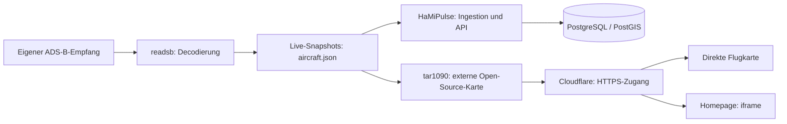

# Fallstudie: HaMiPulse – Vom ADS-B-Signal zur sichtbaren Flugkarte

**Status (16.11.2026):** Öffentlicher Entwurf im Review. Die zwei öffentlich vorgesehenen Zugangswege sind durch den Homepage-Quellcode belegt. Ein realer Linux-Fehlerfall ist technisch dokumentiert und nach lokaler Korrektur funktional bestätigt. Die aktuelle externe Live-Prüfung und ein freigegebener Screenshot stehen noch aus.

## Ziel und Nutzerwert

HaMiPulse verarbeitet die Daten einer eigenen ADS-B-Empfangsstation und stellt einen eigenen Ingestion-/API- und Persistenzzweig mit PostgreSQL/PostGIS bereit. Eine interaktive Flugkarte macht den Live-Empfang für Besucher verständlich sichtbar.

Die eigentliche **Kartendarstellung stammt aus dem Open-Source-Projekt [tar1090](https://github.com/wiedehopf/tar1090)**. Sie ist keine selbst entwickelte .NET-Kartenoberfläche. Der eigene Entwicklungsanteil umfasst insbesondere Empfängerintegration, Datenverarbeitung, Laufzeitintegration, API/Persistenz und die Bereitstellung der Live-Daten.

Die Fallstudie demonstriert eine Zusammenarbeit von Entwickler und ChatGPT mit menschlichen Entscheidungen, nachvollziehbarer Diagnose und überprüfbaren Ergebnissen. Sie ist eine **kuratierte öffentliche Darstellung**, kein Export privater Repositories oder vollständiger Entwicklungsprotokolle.

## Zwei öffentliche Zugangswege zu derselben Karte

1. **[„Der Himmel über Trier“ auf der Homepage](https://millmann.biz/himmel-ueber-trier):** Die Next.js-Seite stellt die Flugkarte in einem responsiven `iframe` dar.
2. **[Direkter Kartenaufruf über Cloudflare](https://flieger.hamipulse.net/tar1090/):** Dieselbe tar1090-Ansicht, die als `iframe` in der Homepage erscheint.

Die URL und Einbettung sind im [öffentlich einsehbaren Homepage-Quellcode](https://github.com/Snahdul/homepage/blob/main/app/himmel-ueber-trier/page.tsx) nachgewiesen. Die Umsetzung der Homepage ist außerdem im öffentlichen [Homepage-Issue #24](https://github.com/Snahdul/homepage/issues/24) nachvollziehbar.

**Wichtig:** Das sind zwei Zugangswege zur gleichen Datenansicht, **keine zwei unabhängig entwickelten Flugkarten**. Eine erneute Prüfung im externen Browser, ob beide Zugänge gerade erreichbar sind, Flugzeuge anzeigen und neue Positionen nachführen, wurde für diese Dokumentationsfassung noch nicht abgeschlossen.

## Die technische Herausforderung

Ein HTTP-erreichbarer Dienst bedeutet nicht automatisch, dass im Browser eine funktionsfähige Flugkarte erscheint. Die Seite kann geladen werden, während einzelne JavaScript-Dateien fehlen; umgekehrt kann tar1090 vollständig geladen sein, obwohl der Decoder noch keine aktuellen ADS-B-Meldungen empfängt.

Deshalb müssen **Webassets, Live-Snapshots, Aktualität, eigene API und Datenbankpersistenz** getrennt diagnostiziert werden.

## Architektur – bewusst abstrahiert

Dies ist ein **logisches Datenflussdiagramm**, keine private Netzwerktopologie. tar1090 verwendet die durch die readsb-basierte Laufzeit bereitgestellten Live-Daten. Der HaMiPulse-Ingestion-/API-Zweig verarbeitet Snapshots für eigene Funktionen und die Datenhaltung. **PostgreSQL und die eigene Aviation-API sind nicht zwangsläufig Teil des Rendering-Pfades jedes tar1090-Flugzeugsymbols.**

Der externe Browser greift über den öffentlichen Cloudflare-Endpunkt auf tar1090 zu – entweder direkt oder innerhalb des Homepage-`iframe`. Interne Hosts, Ports, Routen und produktive Konfigurationen werden nicht veröffentlicht.

### Engineering-Schwerpunkte

- **Schnittstellen:** Datenempfang, Decoder, Snapshot-Bereitstellung, Webassets, Live-Karte und separate Persistenz fachlich trennen.
- **Datenqualität:** Verfügbare, aktuelle und plausible Positionen nicht mit bloßer HTTP-Erreichbarkeit verwechseln.
- **Diagnosefähigkeit:** HTTP-Status von Hauptseite und Assets, Browserfehler und tatsächliche Datenaktualisierung separat prüfen.
- **Iteratives Vorgehen:** Erst ein sichtbares Ergebnis bereitstellen; danach nachgewiesene Engpässe und Fehler gezielt beheben.

## Nachgewiesener Diagnosefall: tar1090-Assets unter Linux

**Ausgangssymptom (12.11.2026):** Nach der Bereitstellung unter Linux war der Kartenendpunkt erreichbar, die Oberfläche konnte aber nicht korrekt initialisieren.

| Prüfpunkt | Vor der Korrektur | Bedeutung |
| --- | --- | --- |
| Hauptseite `/tar1090/` | HTTP 200 | Webserver antwortet |
| JavaScript-Datei `/tar1090/early.js` | HTTP 200 | Einzelne Assets sind verfügbar |
| Bibliothek `/tar1090/libs/jquery-3.6.1.min.js` | HTTP 404 | Verschachteltes Asset wird nicht ausgeliefert |
| Browser-JavaScript | Initialisierungsfehler bei `usp` | Kartenoberfläche funktioniert nicht vollständig |

**Bestätigte Ursache:** Die eigene Asset-Pfadauflösung behandelte den alternativen Verzeichnistrenner plattformübergreifend falsch. Unter Linux ist `Path.AltDirectorySeparatorChar` ebenfalls `/`. Eine Prüfung lehnte dadurch auch legitime Asset-Pfade mit Unterverzeichnissen ab.

**Gezielte Änderung:** Die fehlerhafte Prüfung des alternativen Trennzeichens wurde entfernt; kanonischer Pfadabgleich und Begrenzung auf das vorgesehene Asset-Verzeichnis sowie die Prüfung ungültiger Zeichen bleiben Bestandteil des Sicherheitskonzepts.

**Ergebnis:** Die Korrektur wurde auf dem Linux-Laufzeitsystem angewendet, die betroffene Kartenanwendung erneut bereitgestellt und die wieder funktionierende Karte anschließend vom Entwickler manuell bestätigt. Ein ergänzender Regressionstest für verschachtelte Assets wurde im privaten Entwicklungs-PR vorbereitet. **Ein erfolgreicher CI-Test dieses konkreten Fixes ist hier nicht belegt.** Auch die aktuelle Verfügbarkeit der öffentlichen Karte ergibt sich nicht allein aus diesem historischen lokalen Test.

### Anderes Fehlerbild: Karte ohne aktuelle Flugzeuge

Bei einer gesonderten Diagnose am 10.11.2026 war der Decoderprozess gestartet, empfing jedoch keine aktuellen Daten. Der Datenstrom vom separaten ADS-B-Empfänger war durch eine Firewall-Regel blockiert. Nach gezielter Korrektur des Datenwegs wurden wieder neue Empfangs- und Positionsdatensätze gespeichert. Eine fehlerhafte Zeitbasis wurde als **eigenständiges** Problem untersucht.

Diese Befunde dürfen nicht mit dem späteren Linux-Asset-Problem verwechselt werden. Sie zeigen, warum die Fehlersuche vom sichtbaren Symptom über einzelne technische Übergänge zum tatsächlich gemessenen Befund führen muss.

Die internen Testberichte und Diagnose-PRs dienen als Quelle für diese abstrahierte Darstellung; private Logs, Adressen, Konfigurationen, Quelltexte oder Repositories werden nicht in das öffentliche Referenzprojekt kopiert.

## Zusammenarbeit von Entwickler und ChatGPT

1. **Ziel:** Der Entwickler definiert das sichtbare Ergebnis: eine Karte mit echten, aktuellen Flugbewegungen.
2. **Persistenz:** Aufgaben, Fehler und Akzeptanzkriterien werden in GitHub Issues festgehalten.
3. **Analyse:** ChatGPT unterstützt bei Hypothesen, Prüfverfahren, Varianten und der Strukturierung von Messdaten.
4. **Entscheidung:** Der Entwickler bewertet den Befund und genehmigt gezielte Änderungen.
5. **Abnahme:** Nicht der erfolgreiche Build allein, sondern auch das Verhalten im Browser und der Datenfluss sind ausschlaggebend.
6. **Wissenssicherung:** Geprüfte Ergebnisse und verbleibende Einschränkungen bleiben nachvollziehbar dokumentiert.

Der öffentliche Ablauf dieses **Referenzrepositories** lässt sich am [Dokumentations-PR #9](https://github.com/Snahdul/HaMi-AI-Engineering/pull/9) sowie an nachfolgenden öffentlichen Issues und PRs nachvollziehen. Das ist kein vollständiger öffentlicher Beleg für alle Implementierungsdetails des privaten HaMiPulse-Projekts.

## Nachweise und Grenzen

| Aussage | Vorliegender Beleg | Grenze |
| --- | --- | --- |
| Zwei öffentliche Zugangswege zur Flugkarte | [Homepage-Quellcode](https://github.com/Snahdul/homepage/blob/main/app/himmel-ueber-trier/page.tsx) | Aktueller externer Live-Test steht aus |
| tar1090 als Kartenkomponente Dritter | [tar1090-Projekt](https://github.com/wiedehopf/tar1090) und Homepage-Quellcode | Keine Behauptung einer eigenen Kartenimplementierung |
| Eigener Datenverarbeitungs- und Persistenzzweig | Zeitbezogene interne technische Diagnose und Persistenzprüfung | Kein Beleg für ununterbrochenen Betrieb zum aktuellen Zeitpunkt |
| Linux-Assetfehler und Korrektur | Konkrete HTTP-200/404-Beobachtung, ermittelte Ursache und menschlicher Funktionstest | CI-Regressionstest und öffentliche Vorher-/Nachher-Abbildung noch nicht belegt |
| Öffentliche Veröffentlichung dieser Fallstudie | [Issue #3](https://github.com/Snahdul/HaMi-AI-Engineering/issues/3) und dieser PR | Menschliche Inhalts- und Rechtefreigabe noch offen |

## Akzeptanzkriterien für die Veröffentlichung

- [x] Homepage- und Cloudflare-URL mit ihrer Verknüpfung dokumentiert.
- [ ] Beide URLs aktuell extern auf Anzeige und Positionsaktualisierung geprüft.
- [ ] Freigegebenen, bereinigten Screenshot mit Aufnahmedatum ergänzt.
- [x] Architektur trennt tar1090-Live-Karte und HaMiPulse-Ingestion/Persistenz.
- [x] Realen Diagnosebefund, minimale Korrektur und Grenzen der Validierung dokumentiert.
- [x] Keine internen IP-Adressen, Secrets, privaten Logs oder nicht freigegebenen Quellen übernommen.
- [ ] Menschliche inhaltliche und rechtliche Prüfung sowie ausdrückliche Freigabe des Pull Requests dokumentiert.

**Weiterarbeit:** [Issue #3](https://github.com/Snahdul/HaMi-AI-Engineering/issues/3). Historische erfolgreiche Funktionstests werden nicht als aktuelle, durchgehend verfügbare Live-Daten ausgegeben.
