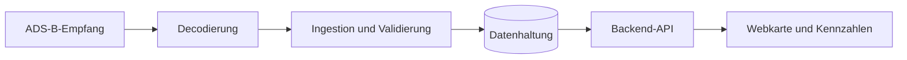

# Fallstudie: HaMiPulse – Vom Flugsignal zur sichtbaren Flugkarte

**Status (15.11.2026):** Öffentlicher Entwurf zur Prüfung. Das Nutzerergebnis ist aus der Projektarbeit bekannt; aktuelle öffentliche Belege und eine abschließend nachgewiesene Fehlerbehebung werden noch ergänzt.

## Ziel und Nutzerwert

HaMiPulse verarbeitet empfangene Flugdaten und stellt Flugbewegungen auf einer interaktiven Webkarte dar. Die Karte wurde in die berufliche Homepage eingebunden. Damit wird aus einer mehrstufigen Datenverarbeitung ein für Besucher unmittelbar verständliches Ergebnis.

Das Projekt ist zugleich ein Beispiel für professionelle Softwareentwicklung mit KI-Unterstützung: Menschliche Zielsetzung und Freigabe, nachvollziehbare Architekturentscheidungen, gezielte Diagnose, schrittweise Umsetzung und überprüfbare Ergebnisse.

**Abgrenzung:** Diese Fallstudie ist eine kuratierte Darstellung. Sie veröffentlicht weder den privaten Quellcode noch den vollständigen privaten Entwicklungsverlauf.

## Das technische Problem

Eine Flugkarte zeigt nur dann verlässliche Informationen, wenn alle Übergänge vom Empfang bis zum Browser funktionieren. Ein startender Dienst oder eine erreichbare Webseite genügt als Funktionsnachweis nicht: Die Oberfläche kann technisch funktionieren und trotzdem keine Flugbewegungen anzeigen.

Die Anwendung muss daher nicht nur komponentenweise, sondern **Ende zu Ende** überprüft werden. Datenverfügbarkeit, Datenaktualität und Benutzeroberfläche sind getrennte Qualitätsmerkmale.

## Architektur – bewusst abstrahiert

Das Diagramm zeigt logische Verantwortlichkeiten, keine Netzwerktopologie. Es enthält keine Serverstandorte, internen Adressen, Zugangsdaten oder produktiven Konfigurationen.

### Engineering-Schwerpunkte

- **Schnittstellen:** Für jede Übergabestelle festlegen, welche Daten erwartet werden und wie Fehler sichtbar werden.
- **Datenqualität:** Empfangene Positionsdaten auf Plausibilität und Aktualität prüfen; fehlende Daten nicht durch scheinbar korrekte Anzeigen verdecken.
- **Diagnosefähigkeit:** Zwischen „Dienst erreichbar“, „Daten vorhanden“, „Daten aktuell“ und „Karte zeigt Daten“ unterscheiden.
- **Iterative Entwicklung:** Früh eine nutzbare Karte bereitstellen und anhand ihres Verhaltens weitere Verbesserungen gezielt priorisieren.

## Ein konkretes Diagnoseszenario

**Beobachtung aus der Projektarbeit:** Nach einem Neustart war die Anwendung erreichbar, aber die Flugkarte blieb leer. Auch die zugehörigen Kennzahlen zeigten keine Flugdaten.

Aus dieser Beobachtung folgt **nicht**, dass die Kartenkomponente fehlerhaft ist. Mindestens folgende Hypothesen müssen unterschieden werden:

| Prüfpunkt | Diagnosefrage | Geeigneter Nachweistyp |
| --- | --- | --- |
| Empfang | Treffen überhaupt Rohdaten ein? | Zeitbezogener, bereinigter Empfangsnachweis |
| Decodierung | Werden verwertbare Meldungen erzeugt? | Anonymisierte Zähler und Zeitstempel |
| Ingestion | Werden Meldungen tatsächlich angenommen und verarbeitet? | Status und Verarbeitungszähler |
| Datenhaltung | Sind passende, aktuelle Datensätze vorhanden? | Aggregierte Datenprüfung ohne interne Details |
| Backend-API | Liefert die API gültige Daten oder nur einen erfolgreichen Gesundheitsstatus? | Bereinigter, öffentlicher Beispiel-Response |
| Webkarte | Werden die gelieferten Daten fachlich korrekt dargestellt? | Funktionstest im Browser und freigegebener Screenshot |

Dies ist ein **systematischer Diagnoseplan**, keine Behauptung, dass sämtliche Prüfungen bereits mit positivem Ergebnis durchgeführt wurden. Die endgültige Fehlerursache, der zugehörige Fix und ein reproduzierbarer Vorher/Nachher-Nachweis sind in dieser öffentlichen Fassung noch **nicht belegt**.

## Zusammenarbeit zwischen Entwickler und ChatGPT

1. **Menschliches Ziel:** Eine funktionierende Karte mit sichtbar aktuellen Flugbewegungen, nicht bloß einen erfolgreich gestarteten technischen Dienst.
2. **Persistenter Auftrag:** GitHub Issues halten Problem, Akzeptanzkriterien und offene Nachweise fest.
3. **KI-Assistenz:** ChatGPT unterstützt beim Eingrenzen von Hypothesen, Entwurf von Prüfungen, Analyse technischer Alternativen und Vorbereitung der Dokumentation.
4. **Technische Bewertung:** Der Entwickler prüft konkrete Befunde, entscheidet über Änderungen und beurteilt die Auswirkungen auf das Gesamtsystem.
5. **Abnahme:** Fachlich beobachtbares Verhalten und erforderliche Qualitäts- und Sicherheitskontrollen entscheiden über die Freigabe.
6. **Wissenssicherung:** Ergebnisse und Entscheidungen werden in Issues, Pull Requests und gegebenenfalls ADRs dokumentiert.

Der öffentliche Entwicklungs- und Freigabeprozess dieses **Referenzrepositories** lässt sich unter anderem am [Dokumentations-PR #9](https://github.com/Snahdul/HaMi-AI-Engineering/pull/9) nachvollziehen. Das ist kein öffentlicher Beleg für sämtliche Implementierungsdetails des privaten HaMiPulse-Projekts.

## Nachweise und ihr Stand

| Aussage | Stand | Noch erforderlich |
| --- | --- | --- |
| Eine Flugkarte wurde in die Homepage integriert | Projektbeobachtung; noch kein aktueller öffentlicher Live-Nachweis in dieser Fallstudie | Freigegebenen, erreichbaren Link einfügen und prüfen |
| Die Karte zeigt tatsächlich empfangene Flugbewegungen | Aus der Projektarbeit bekannt, hier noch nicht unabhängig belegt | Bereinigten Screenshot mit Aufnahmedatum und Kontext ergänzen |
| Empfang, Backend und Darstellung arbeiten durchgängig zusammen | Für den aktuellen Stand nicht nachgewiesen | Zeitbezogene End-to-End-Prüfung dokumentieren |
| Diagnose einer nach Neustart leeren Karte | Symptom dokumentiert; Ursache und Behebung offen | Geprüfte Ursache, Korrektur und Vorher/Nachher-Beleg ergänzen |
| Menschliche Freigabe im öffentlichen Referenzprojekt | Über [PR #9](https://github.com/Snahdul/HaMi-AI-Engineering/pull/9) nachvollziehbar | Für diese Fallstudie durch eigenen PR ergänzen |

## Akzeptanzkriterien für die Veröffentlichung

- [ ] Freigegebener öffentlicher Link zur Flugkarte wurde tatsächlich auf Erreichbarkeit und Nutzbarkeit geprüft.
- [ ] Ein bereinigter Screenshot belegt ein sichtbares Ergebnis und nennt seinen Aufnahmezeitpunkt.
- [x] Ein abstrahiertes Datenflussdiagramm erklärt die Verantwortlichkeiten.
- [x] Das Diagnoseszenario unterscheidet Beobachtung, Hypothese, Prüfung und unbelegtes Ergebnis.
- [ ] Ein konkreter Befund und seine Validierung sind mit veröffentlichbaren Nachweisen ergänzt; andernfalls wird die Einschränkung deutlich beibehalten.
- [ ] Keine privaten Quelltexte, internen Adressen, Secrets, Logs oder nicht freigegebenen Inhalte wurden übernommen.
- [ ] Menschliche Inhaltsprüfung und Freigabe im zugehörigen Pull Request dokumentiert.

**Weiterarbeit:** [Issue #3](https://github.com/Snahdul/HaMi-AI-Engineering/issues/3). Alle nicht überprüften Nachweise bleiben bewusst offen.
